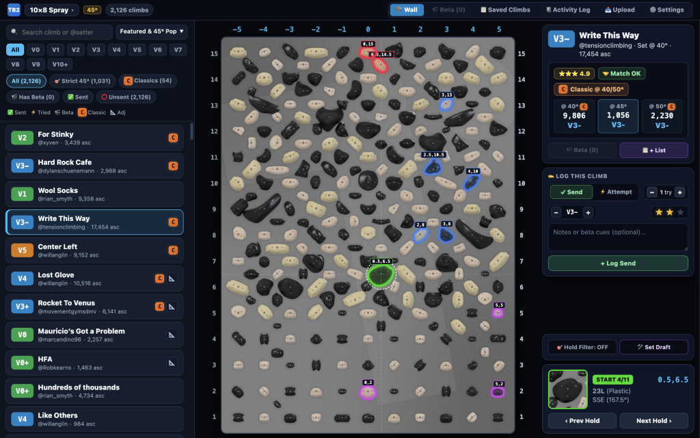

# TB2 Board Lab

A free, fast, local-first desktop web app for **Tension Board 2** climbers. Browse every climb that fits your exact board layout and size, get accurate consensus grades for any fixed or adjustable angle, log ticks with grade ratings & stars, organize custom lists, and sync two-way with your Tension Board 2 account—right from your browser.

No cloud account, no subscription, and **zero Python packages (`pip install`) required**.

> **Want to quickly try it without downloading, logging in, saving to Tension, or viewing beta videos?**  
> 👉 **[Try the Live Browser Demo HERE](https://germuth.github.io/tb2-board-lab/)** *(shows the 10×8 Spray @ 45° board directly in your browser — download locally below for 2-way Tension sync, all board sizes/angles, and beta videos).*



---

## Quick Start (No Terminal Required)

### Option 1: Standalone Download (Easiest — No Python Needed)
Grab the latest zip from the **Releases** page:
- **Windows:** Unzip `TB2-Board-Lab-Windows.zip` and double-click **`TB2-Board-Lab.exe`**.
  *(If Windows SmartScreen warns about an unrecognized app, click **More info → Run anyway**.)*
- **macOS:** Unzip `TB2-Board-Lab-macOS.zip` and double-click **`TB2-Board-Lab`**.
  *(First time on macOS: if Gatekeeper blocks the unsigned app, open **System Settings → Privacy & Security**, scroll down, and click **Open Anyway**.)*

Your browser will open automatically to `http://127.0.0.1:8855`.

### Option 2: Run Directly from Source (Python 3.8+)
Click **Code → Download ZIP** (or `git clone` this repo), unzip it, then:

- **Windows:** Double-click **`Start TB2 Board Lab.bat`**
  *(If Python isn't installed yet, the launcher walks you through a 1-click download from python.org or `winget` install.)*
- **macOS:** Double-click **`Start TB2 Board Lab.command`**
  *(First time on macOS: if blocked by Gatekeeper, go to **System Settings → Privacy & Security → Open Anyway**. If Python isn't installed yet, the launcher offers to open python.org for you.)*
- **Linux:** Run **`bash start.sh`** *(or double-click / run `./start.sh` — Python 3 is pre-installed on most Linux distros)*

On first launch, pick your Tension Board 2 layout (Spray or Mirror), wall size (`10×8`, `12×8`, `10×12`, or `12×12`), and angle (`15°–70°`, fixed or adjustable). TB2 Board Lab automatically downloads the latest public climb database and builds your local board catalog.

---

## Key Features

- **Any Tension Board 2 Setup:** Supports Spray & Mirror layouts across standard sizes and any fixed or adjustable wall angle (`15°–70°`).
- **Multi-Angle Consensus Grading:** Fixed-angle home and gym boards often suffer from sparse or inverted grades when a climb has hundreds of sends at `40°` and only two at `45°`. TB2 Board Lab blends official Tension Classics and adjacent-angle consensus data into a realistic grade for *your* exact angle.
- **Full 2-Way Tension App Sync:** Connect your Tension Board 2 account to pull your ascents, bids/attempts, circuits, draft climbs, and followed climbers—and push new logs, edits, and drafts straight back to Tension.
- **Grade Rating (Sandbag / Upgrade) & 1–3 Star Quality:** Rate how a climb actually felt compared to the consensus grade and submit 1–3 star quality ratings directly when logging ticks.
- **Interactive Wall, Search & Custom Lists:** Filter by grade, Classics, setter, holds, repeat count, or logged status; build custom lists and draft new climbs directly on the board.
- **Beta Clips & Optional Video Tools:** Attach Instagram beta links or local session clips and review/compare them side-by-side or with a ghost overlay. If you have optional command-line tools installed, TB2 Board Lab unlocks extra video features automatically:
  - **`yt-dlp`**: Stream Instagram Reels and multi-slide posts directly inside the app.
  - **`ffmpeg` + `ffprobe`**: Trim uploaded local session clips to start/end timestamps.

---

## Privacy & Security

- **Local-only by default:** The server binds to `127.0.0.1` (your computer only) so nothing is exposed to your local network unless you explicitly pass `--host 0.0.0.0`.
- **Your password is never stored:** Logging into Tension exchanges your credentials directly with `tensionboardapp2.com` over HTTPS for a session token. Only the token is saved locally in `user_data/aurora_sessions.json` (with `chmod 600` owner-only permissions on macOS/Linux).
- **All personal data stays in `user_data/`:** Your config, logbook, lists, cached catalogs, and videos live strictly inside the local `user_data/` folder (git-ignored) and are never sent to any third-party analytics or backend server.

---

## Command-Line Options

For advanced setups (custom port, LAN access for a phone/tablet in your home gym, or a custom data folder):

```bash
python3 server.py --host 0.0.0.0 --port 8855 --open-browser --data-dir /path/to/data
```

| Flag | Default | Description |
| :--- | :--- | :--- |
| `--host` | `127.0.0.1` | Bind address (`0.0.0.0` allows phones/tablets on your Wi-Fi to connect) |
| `--port` | `8855` | HTTP port |
| `--open-browser` | off *(on for packaged app)* | Automatically open TB2 Board Lab in your default browser |
| `--no-browser` | off | Suppress auto-opening the browser in packaged builds |
| `--data-dir` | `./user_data` *(or `TB2_DATA_DIR`)* | Directory for `config.json`, `state.json`, tokens, cache, and videos |

---

## Credits & License

- Public climb database snapshots are fetched from the open-source [Boardsesh](https://github.com/marcossegovia/boardsesh) project.
- Tension Board 2 is a trademark of Tension Climbing. TB2 Board Lab is an independent, community-built open-source tool and is not affiliated with Tension Climbing or Aurora Climbing.
- Licensed under the [MIT License](LICENSE).
